# ELT with Airflow, dbt and Snowflake

[](https://github.com/dileepambati-cloud/elt-airflow-dbt-snowflake/actions/workflows/ci.yml)

An ELT pipeline for healthcare payer data (members, providers, claims, claim lines).
Raw extracts are loaded into Snowflake as-is, then **dbt** turns them into tested,
documented staging and mart models, and **Airflow** orchestrates the run.

> All data is synthetic - generated by `scripts/generate_raw_data.py`.

## Layers

```
 raw extracts (CSV)                 Snowflake / DuckDB
 ┌───────────────┐   COPY INTO    ┌─────────┐  dbt  ┌───────────┐  dbt  ┌──────────────┐  dbt  ┌──────────────────┐
 │ members       │ ─────────────> │  raw    │ ────> │ staging   │ ────> │ intermediate │ ────> │ marts            │
 │ providers     │  (seeds in     │         │       │ clean,    │       │ line rollups │       │ dim_member (SCD2)│
 │ claims        │   dev / CI)    │         │       │ typed,    │ ────> │──────────────│       │ dim_provider     │
 │ claim_lines   │                └─────────┘       │ deduped   │       │ snapshots    │       │ fct_claims       │
 └───────────────┘                                  └───────────┘       │ snp_members  │       │ mart_pmpm_monthly│
                                                                        └──────────────┘       └──────────────────┘
```

| Layer | Schema | What happens |
|---|---|---|
| raw | `raw` | Files loaded exactly as delivered - nothing fixed here |
| staging | `staging` | One view per source table: trim, upper-case codes, cast types, dedupe |
| intermediate | `intermediate` | Reusable building blocks (claim lines rolled up per claim) |
| snapshots | `snapshots` | `snp_members` - SCD Type 2 history of members (timestamp strategy on `updated_at`) |
| marts | `marts` | Star schema + reporting tables for BI |

## Data model

```mermaid
erDiagram
    dim_member ||--o{ fct_claims : "member_id"
    dim_provider ||--o{ fct_claims : "provider_id"
    fct_claims }o--|| mart_pmpm_monthly : "service_month + plan"

    dim_member {
        string member_key PK "one per version"
        string member_id
        string plan_code
        timestamp valid_from
        timestamp valid_to "9999-12-31 if current"
        boolean is_current
    }
    dim_provider {
        string provider_id PK "plus UNKNOWN row"
        string npi
        string specialty
        string state
    }
    fct_claims {
        string claim_id PK
        string member_id FK
        string provider_id FK
        date service_month
        decimal billed_amount
        decimal paid_amount
        int days_to_receive
        int times_delivered
    }
    mart_pmpm_monthly {
        date month_start
        string plan_code
        int member_months
        decimal paid_amount
        decimal pmpm
        decimal denial_rate_pct
    }
```



| Model | Grain | Notes |
|---|---|---|
| `dim_member` | member version | From the snapshot; `is_current` for today's view, `valid_from`/`valid_to` for point-in-time joins |
| `dim_provider` | provider | Includes an `UNKNOWN` row so claims with unmatched providers still join and totals reconcile |
| `fct_claims` | claim | **Incremental**, merge on `claim_id` with a 3-day lookback on `loaded_at` - a re-delivered claim updates in place |
| `mart_pmpm_monthly` | month x plan | Paid per member per month: `paid_amount / member_months`, plus claim count and denial rate |

## What the raw data looks like

The generator makes the extracts messy on purpose, the way real feeds are:

| Problem in raw | Handled in |
|---|---|
| A pending claim is re-delivered with its final status (same `claim_id`, later `_loaded_at`) | `stg_claims` keeps the latest delivery, records `times_delivered` |
| Status / gender values like `' paid'`, `Denied `, `m` | `upper(trim(...))` in staging, `accepted_values` tests |
| Claims pointing at providers missing from the provider file | `relationships` test, **warn** (don't block the load) |
| `paid_amount` > `billed_amount` on a few claims | custom `not_greater_than` test, **warn** |
| Header totals not matching the sum of the lines | singular test `assert_claim_lines_sum_to_header`, **warn** |

Hard failures (`error`) are kept for things that make the data unusable - null or
duplicate keys, unknown status codes, claims for members that don't exist.

## Tests

- **Generic:** `not_null`, `unique`, `accepted_values`, `relationships`
- **Custom generic** (`tests/generic/`): `not_greater_than`, `non_negative`
- **Singular** (`tests/`):
  - header vs. line reconciliation (warn)
  - `fct_claims` carries every claim and every dollar from staging (error)
  - exactly one current version per member in `dim_member` (error)
  - one PMPM row per month and plan (error)
- **Source:** keys + freshness on `raw.claims` (`_loaded_at`)

Current CI result: **9 models, 1 snapshot, 65 data tests - PASS=76, WARN=3, ERROR=0**
(the 3 warnings are the planted source problems above).

## Run it locally (no Snowflake needed)

```bash
python -m venv .venv
source .venv/bin/activate              # Windows: .venv\Scripts\activate
pip install -r requirements.txt

python scripts/generate_raw_data.py    # refresh seeds/raw/*.csv (already committed)

export DBT_PROFILES_DIR=$PWD           # Windows: set DBT_PROFILES_DIR=%cd%
dbt build --target dev                 # seeds -> staging views -> all tests, in DuckDB
dbt docs generate && dbt docs serve    # browse models, columns and lineage
```

The `dev` target writes to a local `payer.duckdb` file. The `snowflake` target in
`profiles.yml` reads its connection from `SNOWFLAKE_*` environment variables.

## Snowflake

Scripts in `snowflake/`, run in order:

| Script | Role | What it does |
|---|---|---|
| `01_setup.sql` | SYSADMIN / SECURITYADMIN | XSMALL warehouses (load / transform / report, 60s auto-suspend), `PAYER` database, `raw` / `staging` / `snapshots` / `marts` schemas, and three roles: `LOADER` (write raw), `TRANSFORMER` (read raw, build the rest), `REPORTER` (read marts) |
| `02_raw_objects.sql` | LOADER | CSV file format (`parse_header`), internal stage, raw tables with `_file_name` / `_copied_at` audit columns |
| `03_load_raw.sql` | LOADER | `COPY INTO` with `match_by_column_name`: members / providers are full refreshes, claims / lines append new files only (Snowflake's load history makes re-runs safe) |

Then build with dbt against the warehouse:

```bash
export SNOWFLAKE_ACCOUNT=... SNOWFLAKE_USER=... SNOWFLAKE_PASSWORD=...
dbt build --target snowflake --exclude resource_type:seed   # raw comes from COPY INTO, not seeds
```

## CI

Every push and pull request runs `.github/workflows/ci.yml`:

- `python` - ruff + tests for the data generator
- `dbt` - `dbt debug`, `dbt build` (seeds, models, tests) and `dbt docs generate` against
  DuckDB; run results and docs are uploaded as an artifact

## Roadmap

- [x] Raw data generator with realistic source problems
- [x] dbt project: sources, staging models, generic / custom / singular tests, docs
- [x] CI building the project on every push / PR
- [x] Snowflake setup: warehouses, roles, stage, file format, `COPY INTO` raw tables
- [x] Marts: incremental claims fact, member dimension with SCD2 history (snapshot), provider dim, monthly PMPM
- [ ] Airflow DAG: load raw → `dbt build` → notify
- [ ] Slim CI on pull requests (only changed models + downstream)

## Tech

dbt (core + duckdb + snowflake adapters), Snowflake, DuckDB, Airflow, Python, GitHub Actions
